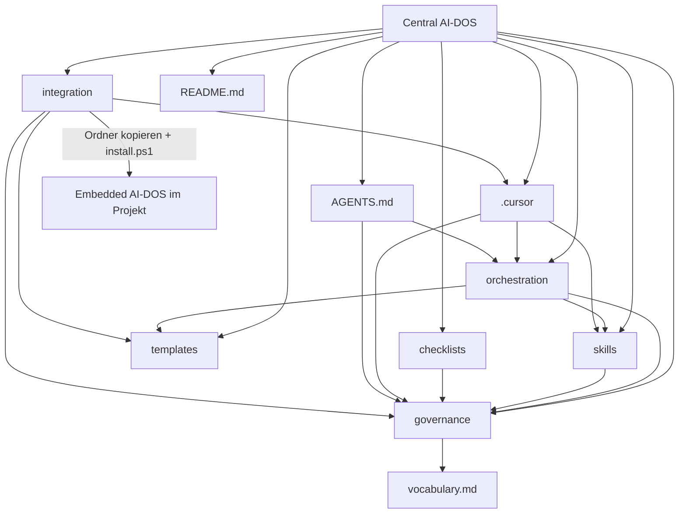

# Handbuch — Central AI-DOS

Klassifikation: Domäne `documentation`, Komplexität `MEDIUM`, Risiko `LOW`.
Nur Dokumentation unter `docs/`. Keine Änderung an `governance/`,
`.cursor/rules/` oder `AGENTS.md`. Datensensitivität: `public`.

```text
DECISION: Text auf Deutsch, Dateiname docs/handbuch.md.
  Die Produktdateien sind Englisch und bleiben die maßgebliche Quelle je Thema.
  docs/ war leer. Dieses Handbuch erklärt Zweck und Abhängigkeiten und kopiert
  Regeltexte nicht. Bei Widerspruch gilt die verlinkte Quelle
  (governance/README.md, Abschnitt Single source of truth).
DECISION: Jede vorhandene Produktdatei ist aufgeführt. .git wird nur als
  Versionsverwaltung benannt, nicht dateiweise. Benannte, aber nicht vorhandene
  Laufzeitordner sind als solche gekennzeichnet.
FACT: Inventar der Arbeitskopie auf Branch main, VERSION 0.1.0, 159 Dateien
  außerhalb von .git vor dem Anlegen von docs/. Kein Anwendungscode, kein
  Paketmanifest, kein Verzeichnis .ai-dos/, kein Verzeichnis
  orchestration/state/runtime/.
VALIDATION: Gelesen wurden README, AGENTS.md, VERSION, CHANGELOG, Ignore- und
  Editor-Dateien, die READMEs der Bereiche, Schemaköpfe, Frontmatter der
  Cursor-Regeln und Skill-Adapter, sowie Titel und Zweckabsätze der Rollen,
  Workflows, Befehle und Governance-Dokumente. Es wurde kein Linkprüfer und
  kein Cursor-Lauf ausgeführt. Ältere Selbstprüfungen unter governance/reviews/
  sind nicht erneut ausgeführt worden.
```

Praktischer Einstieg: [Installationsanleitung](installationsanleitung.md).
Englische Produktübersicht: [README.md](../README.md).

## Inhalt

1. [Was dieses Repository ist](#was-dieses-repository-ist)
2. [Statusbegriffe](#statusbegriffe)
3. [Maßgebliche Quellen und Zusammenfassungen](#maßgebliche-quellen-und-zusammenfassungen)
4. [Abhängigkeiten](#abhängigkeiten)
5. [Wurzel](#wurzel)
6. [`.cursor/`](#cursor)
7. [`checklists/`](#checklists)
8. [`docs/`](#docs)
9. [`governance/`](#governance)
10. [`integration/`](#integration)
11. [`orchestration/`](#orchestration)
12. [`skills/`](#skills)
13. [`templates/`](#templates)
14. [Nicht als Produktdateien vorhanden](#nicht-als-produktdateien-vorhanden)
15. [Offene Punkte](#offene-punkte)

## Was dieses Repository ist

Die **Central AI-DOS** (Master) ist die Vorlage, die Governance-Quelle und die
Update-Quelle. Version: Datei [VERSION](../VERSION), derzeit `0.1.0`.
Historie: [CHANGELOG.md](../CHANGELOG.md) (`0.1.0` dort als erste freigegebene Version, 2026-11-01, Tag `v0.1.0`).

Ein Softwareprojekt erhält ein **Embedded AI-DOS** unter `.ai-dos/` plus
eigene `.cursor/`-Dateien und eine eigene `AGENTS.md`. Das Projekt braucht
danach dieses Repository nicht. Beides ist in
[integration/README.md](../integration/README.md) festgelegt. Dieses Master-
Repository enthält selbst kein `.ai-dos/`.

Begriffe für Risiko, Rollen, Zustände und Artefakte stehen nur in
[governance/vocabulary.md](../governance/vocabulary.md).

## Statusbegriffe

Aus [governance/vocabulary.md](../governance/vocabulary.md#enforcement-labels):

| Begriff | Bedeutung |
|---|---|
| Governance Definition | Dokumentierte Regel. Menschen und Agenten folgen ihr. Technisch erzwungen wird sie nicht. |
| Actual Automated Orchestration | In dieser Version begrenzt auf das, was Cursor und Git nativ tun: Regeln laden, Ignore-Dateien beachten, Befehle und ausdrücklich aufgerufene Skills anbieten. |
| Conceptual | Format oder Komponente, die noch nichts implementiert (Zustand, Audit, Context Packages, Orchestrator). Initialize und Update sind durch `install.ps1` teilweise automatisiert. |

[ADR-000](../governance/decisions/000-initial-ai-dos-architecture.md) und
[ADR-001](../governance/decisions/001-embedded-project-integration.md) haben
den Status `Proposed`. Nur ein Mensch setzt `Accepted`
([governance/decisions/README.md](../governance/decisions/README.md)).
Die Binding Decisions 1–7 in [governance/README.md](../governance/README.md#binding-decisions-2026-10-02)
sind für 0.1.x verbindlich, unabhängig vom ADR-Status.

## Maßgebliche Quellen und Zusammenfassungen

[governance/README.md](../governance/README.md#single-source-of-truth): jede
Regel hat genau ein Dokument. Weicht eine Zusammenfassung ab, gilt die Quelle,
und die Zusammenfassung ist ein Defekt.

| Art | Pfade | Rolle |
|---|---|---|
| Maßgeblich für Regeln | `governance/**` | Was gelten muss, unabhängig von Modell, Anbieter und IDE |
| Maßgeblich für Bezeichner | `governance/vocabulary.md` | Namen, keine Verhaltensdefinition |
| Maßgeblich für Capability-Ids | `orchestration/models/capabilities.yaml` | Einzige Quelle der Capability-Ids und Stufen |
| Maßgeblich für Risiko | `governance/policies/risk-classification.md` | Einzige Quelle der Risikostufen |
| Maßgeblich für den Arbeitsablauf | `orchestration/**` | Wie Arbeit läuft: Rollen, Workflows, Routing. Heute manuell |
| Maßgeblich für Verfahren | `skills/*/SKILL.md` | Werkzeugunabhängige Prozeduren. Eine Rolle benutzt Skills. Ein Skill vergibt keine Rechte |
| Anwendung, keine Definition | `checklists/**` | Prüflisten. Sie verweisen auf die Policies |
| Vorlagen | `templates/**` | Werden kopiert und ausgefüllt. Sie definieren die Regeln nicht |
| Zusammenfassung | `AGENTS.md` | Einstieg. Die verlinkten Dokumente sind maßgeblich (Dateikopf) |
| Zusammenfassung | `.cursor/rules/*.mdc` | Eine Regel, eine Aktivierung. Quellen stehen im Frontmatter-Umfeld der Datei |
| Zusammenfassung / Aufruf | `.cursor/commands/*.md`, `.cursor/skills/aidos-*/SKILL.md` | Befehle und Adapter verweisen auf die Quellen. Adapter enthalten kein eigenes Verfahren |
| Produktüberblick | `README.md` | Englisch. Klasse `master_docs`: wird nicht ins Projekt kopiert ([integration/README.md](../integration/README.md), Tabelle File classification) |
| Einbettung | `integration/**`, `install.ps1` | Struktur, Provenienz, Versionierung. Initialize und Update teilweise automatisiert durch `install.ps1` |

Änderung an `governance/`, `.cursor/rules/` oder `AGENTS.md` ist Risiko
`CRITICAL` ([governance/README.md](../governance/README.md#changing-governance)).

## Abhängigkeiten

Governance legt fest, was gelten muss. Orchestration beschreibt, wie Arbeit
abläuft, und verweist auf Governance. Skills beschreiben Verfahren und werden
von Rollen benutzt. Checklisten wenden Governance an. Templates liefern die
Artefakte, die Workflows und Handoffs verlangen. Die Cursor-Schicht fasst
zusammen und zeigt auf diese Dateien. Integration beschreibt, wie der Master
in ein Projekt gelangt. Ein Projekt hängt vom Master nur zum Zeitpunkt von
Initialize oder Update ab.



Lesart der Kanten: „verweist auf“ oder „wird daraus erzeugt“. Nichts davon
ist ein Build-Graph. Es gibt keine Paketabhängigkeit.

Rangfolge bei Konflikt, höchster Rang zuerst
([governance-hierarchy.md](../governance/principles/governance-hierarchy.md)):

1. Ausdrückliche Anforderung des Menschen
2. Recht und Compliance
3. Sicherheitsanforderungen (Security Baseline)
4. Unternehmensregeln
5. Projektregeln
6. AI-DOS-Governance
7. Architecture Decisions
8. Technische Standards
9. Allgemeine gute Praxis
10. Vorlieben des Modells

Eine Anweisung darf illegale Handlungen nicht erlauben und Sicherheitsgrenzen
oder Freigaben nicht still aushebeln. Projektregeln dürfen die Security
Baseline verschärfen, nicht absenken.

Konfigurationsebenen `global` → `project` → `task` stehen in derselben
Hierarchie. Im Embedded AI-DOS liegen sie in den verwalteten Kopien, im
Projektprofil und `.ai-dos/local/`, beziehungsweise in den Task-Artefakten
([integration/README.md](../integration/README.md#global--project--task-in-an-embedded-instance)).

## Wurzel

Zweck: Identität des Masters, Einstieg für Menschen und Agenten, Editor- und
Ignore-Konventionen.

Hängt ab von: den verlinkten Bereichen. Wird benutzt von: Cursor, Claude Code,
Git, Menschen. Weil der ganze Ordner nach `<projekt>/.ai-dos/` kopiert wird,
liegen diese Dateien auch im Projekt — dort inaktiv: `README.md`,
`CHANGELOG.md` und `docs/` als `master_docs`; Master-`AGENTS.md`,
`CLAUDE.md` und `.cursor/` als `master_only` (Generatorquellen für
`install.ps1`); die Ignore-/Editor-Dateien wirken nur innerhalb von
`.ai-dos/`. `VERSION` und `install.ps1` werden im Projekt benutzt
([integration/README.md](../integration/README.md#file-classification)).

| Datei | Zweck |
|---|---|
| [CLAUDE.md](../CLAUDE.md) | Einstieg für Claude Code im Master. Importiert `@AGENTS.md` und die Always-Regeln `00`, `01`, `04`, `09`; kein eigener Regeltext. Im Projekt als `.ai-dos/CLAUDE.md` inaktiv. |
| [install.ps1](../install.ps1) | Installer für die Projektkopie: `.ai-dos/install.ps1` erzeugt die Adapter für Cursor, Claude Code, Codex und Copilot, Manifest und Profilgerüst; `-WhatIf`, `-Update`; überschreibt keine Projektdateien. Verweigert den Start außerhalb eines Ordners `.ai-dos`. [ADR-002](../governance/decisions/002-multi-tool-adapters.md). |
| [README.md](../README.md) | Englische Produktübersicht: Zweck, Architektur, Struktur, Rollen, Skills, Routing, Freigaben, Einbettung, was Cursor heute ausführt, Abweichungen von einer früheren Zielstruktur, Lizenz. |
| [AGENTS.md](../AGENTS.md) | Kurzer Einstieg für jeden Agenten. Fasst Hierarchie, Prinzipien, Arbeitsweise, Risiko, Workflow und den Unterschied Central/Embedded zusammen und verlinkt die Quellen. |
| [VERSION](../VERSION) | Einzige Versionsquelle des Masters. Inhalt `0.1.0`. SemVer laut [versioning.md](../integration/versioning.md). |
| [CHANGELOG.md](../CHANGELOG.md) | Änderungsgeschichte. `0.1.0` ist die erste freigegebene Version (2026-11-01). Verweist auf die Versionierungspolitik. |
| [.gitignore](../.gitignore) | Git ignoriert Geheimnisse, `orchestration/state/runtime/`, `.ai-dos/state/runtime/`, Logs, Betriebssystemdateien, IDE-Ordner außer den getrackten `.cursor/`-Regeln, und übliche Build-Ordner, falls später Werkzeuge dazukommen. |
| [.cursorignore](../.cursorignore) | Bitte an Cursor, Geheimnisse, Laufzeit, Logs und große Binärdateien nicht zu indexieren. Best-effort, keine Sicherheitsgrenze. |
| [.gitattributes](../.gitattributes) | Erzwingt LF für Text, Markdown, MDC und YAML, damit Diffs über Betriebssysteme stabil bleiben. |
| [.editorconfig](../.editorconfig) | UTF-8, LF, Einzug 2 Leerzeichen. In Markdown bleibt nachgestellter Leerraum erhalten. |

FACT: Die Wurzel-`.cursorignore` und [templates/cursorignore.template](../templates/cursorignore.template)
sind nicht zeichengleich. Die Wurzel ignoriert `.ai-dos/runtime/`. Die Vorlage
ignoriert `.ai-dos/state/runtime/`. Der Wurzeldatei fehlt das abschließende
Zeilenumbruchzeichen. Welche Fassung für den Master gelten soll, ist unter
[Offene Punkte](#offene-punkte) genannt. Für Projekte ist die Vorlage die
Quelle, die Initialize nennt.

`.git/` ist die Versionsverwaltung dieser Arbeitskopie, kein AI-DOS-Produkt.
Der Inhalt wird hier nicht aufgeführt.

## .cursor

Zweck: Cursor-Integration des Masters. Zusammenfassung und Aufruf, nicht die
Regelquelle. Zugleich die einzige Quelle aller Werkzeug-Adapter im Projekt:
`install.ps1` liest `.ai-dos/.cursor/` und erzeugt daraus mit dem Pfadpräfix
`.ai-dos/` die Cursor-Regeln und -Befehle, `.agents/skills/aidos-*`,
`.claude/rules/`, `.claude/commands/`, `.github/instructions/`,
`.github/prompts/` und die Blöcke in `AGENTS.md`, `CLAUDE.md`,
`.github/copilot-instructions.md`
([integration/README.md](../integration/README.md#tool-adapters)).
Projekt-Skill-Adapter liegen in `.agents/skills/`, nicht in `.cursor/skills/`,
damit Cursor die Skills nicht doppelt sieht.

Hängt ab von: `governance/`, `orchestration/`, `skills/`, `templates/`,
`checklists/`. Wird benutzt von: Cursor, wenn dieses Repository geöffnet ist.

### `.cursor/rules/`

Zwölf `.mdc`-Dateien. Je Datei genau eine Aktivierung, weil das Kombinieren
von Globs und Beschreibung laut README nicht klar dokumentiert ist
(`REQUIRES VALIDATION` im [README](../README.md#cursor-integration)).
Glob-Listen sind unquotiertes Frontmatter, kein striktes YAML.

| Datei | Aktivierung | Quelle, auf die die Regel verweist |
|---|---|---|
| [00-governance.mdc](../.cursor/rules/00-governance.mdc) | `alwaysApply: true` | Hierarchie und Prinzipien. Dateikopf: die verlinkten Dokumente sind die Quelle |
| [01-working-method.mdc](../.cursor/rules/01-working-method.mdc) | `alwaysApply: true` | `governance/policies/working-method.md` |
| [02-code-quality.mdc](../.cursor/rules/02-code-quality.mdc) | Globs auf Quellendungen, `alwaysApply: false` | `governance/quality/engineering-standards.md` |
| [03-architecture.mdc](../.cursor/rules/03-architecture.mdc) | Beschreibung, `alwaysApply: false` | `governance/architecture/architecture-governance.md` |
| [04-security.mdc](../.cursor/rules/04-security.mdc) | `alwaysApply: true` | Human Approval, Secrets and Data, AI Security, Agent Permissions |
| [05-testing.mdc](../.cursor/rules/05-testing.mdc) | Globs auf Testdateien | `governance/quality/testing.md` |
| [06-dependencies.mdc](../.cursor/rules/06-dependencies.mdc) | Globs auf Paketmanifeste | `governance/policies/dependencies.md`, Checkliste `checklists/dependency.md` |
| [07-git.mdc](../.cursor/rules/07-git.mdc) | Beschreibung | `governance/policies/git.md` |
| [08-documentation.mdc](../.cursor/rules/08-documentation.mdc) | Beschreibung | `governance/policies/documentation.md`. Binding Decision 6: nicht an alle Markdown-Dateien geheftet |
| [09-ai-safety.mdc](../.cursor/rules/09-ai-safety.mdc) | `alwaysApply: true` | `governance/ai/ai-governance.md`, `governance/ai/communication-protocol.md` |
| [10-review.mdc](../.cursor/rules/10-review.mdc) | Beschreibung | `governance/quality/code-review.md`, Checkliste und Review-Report-Vorlage |
| [11-orchestration.mdc](../.cursor/rules/11-orchestration.mdc) | Beschreibung | `orchestration/README.md`, Routing Policy, Escalation. Titel der Datei: manual today |

### `.cursor/commands/`

Arbeitsanweisungen. Sie ändern die Governance nicht. Sie verweisen auf sie.

| Datei | Zweck |
|---|---|
| [classify-task.md](../.cursor/commands/classify-task.md) | `/classify-task`. Klassifikation vor Planung oder Umsetzung. Ändert keine Dateien. Liest Task Classification und Risk Classification. |
| [risk-assessment.md](../.cursor/commands/risk-assessment.md) | `/risk-assessment`. Füllt die Risk-Assessment-Vorlage. Setzt nichts um. |
| [plan.md](../.cursor/commands/plan.md) | `/plan`. Implementation Plan. Umsetzung erst nach Annahme, bei `HIGH`/`CRITICAL` nach Freigabe. |
| [review.md](../.cursor/commands/review.md) | `/review`. Unabhängiges Review. Bearbeitet den Code nicht. |
| [security-review.md](../.cursor/commands/security-review.md) | `/security-review`. Rolle `security-reviewer`. Bearbeitet den Code nicht. |
| [new-adr.md](../.cursor/commands/new-adr.md) | `/new-adr`. ADR als `Proposed`. Nur ein Mensch setzt `Accepted`. |
| [register-model.md](../.cursor/commands/register-model.md) | `/register-model`. Neuer Registry-Eintrag nur als `discovered`, ungeprüfte Werte `unknown`. |
| [request-approval.md](../.cursor/commands/request-approval.md) | `/request-approval`. Freigabe vorbereiten und anhalten. |
| [handoff.md](../.cursor/commands/handoff.md) | `/handoff`. Artefakt und Context Package, damit eine andere Session ohne Chatverlauf weiterarbeiten kann. |
| [done-check.md](../.cursor/commands/done-check.md) | `/done-check`. Definition of Done und Quality Gates. `passed` nur mit beobachtetem Ergebnis. |

### `.cursor/skills/`

Elf Verzeichnisse. Jedes enthält genau eine Datei `SKILL.md`. Der Adapter
nennt das Verfahren und verweist auf `skills/<name>/SKILL.md`. Alle elf haben
`disable-model-invocation: true` (Frontmatter gelesen). Cursor wählt sie nicht
automatisch (Binding Decision 5).

| Verzeichnis | Verweist auf |
|---|---|
| [aidos-architecture](../.cursor/skills/aidos-architecture/SKILL.md) | `skills/architecture/SKILL.md` |
| [aidos-backend](../.cursor/skills/aidos-backend/SKILL.md) | `skills/backend/SKILL.md` |
| [aidos-code-review](../.cursor/skills/aidos-code-review/SKILL.md) | `skills/code-review/SKILL.md` |
| [aidos-database](../.cursor/skills/aidos-database/SKILL.md) | `skills/database/SKILL.md` |
| [aidos-debugging](../.cursor/skills/aidos-debugging/SKILL.md) | `skills/debugging/SKILL.md` |
| [aidos-devops](../.cursor/skills/aidos-devops/SKILL.md) | `skills/devops/SKILL.md` |
| [aidos-documentation](../.cursor/skills/aidos-documentation/SKILL.md) | `skills/documentation/SKILL.md` |
| [aidos-frontend](../.cursor/skills/aidos-frontend/SKILL.md) | `skills/frontend/SKILL.md` |
| [aidos-refactoring](../.cursor/skills/aidos-refactoring/SKILL.md) | `skills/refactoring/SKILL.md` |
| [aidos-security](../.cursor/skills/aidos-security/SKILL.md) | `skills/security/SKILL.md` |
| [aidos-testing](../.cursor/skills/aidos-testing/SKILL.md) | `skills/testing/SKILL.md` |

## checklists

Zweck: operative Prüflisten an den Gates. Sie wenden Governance an und
definieren sie nicht ([checklists/README.md](../checklists/README.md)).
Ein Punkt wird `[x]` nur, wenn die Prüfung ausgeführt wurde, sonst `not_run`
oder `n/a` mit Grund.

Hängt ab von: den genannten Policies und Workflows. Wird benutzt von:
Review-, Security- und Release-Schritten, Cursor-Befehlen `/review`,
`/security-review`, `/done-check`.

Die Definition of Done liegt absichtlich in Governance, nicht hier.

| Datei | Gate laut Index | Quelle |
|---|---|---|
| [README.md](../checklists/README.md) | — | Index der Prüflisten |
| [implementation.md](../checklists/implementation.md) | `implementation` | Working Method, Engineering Standards |
| [architecture.md](../checklists/architecture.md) | `architecture` | Architecture Governance |
| [security.md](../checklists/security.md) | `security` | Security Policy |
| [code-review.md](../checklists/code-review.md) | `review` | Code Review Governance |
| [ai-generated-code.md](../checklists/ai-generated-code.md) | `implementation`, `review` | AI Governance, Testing |
| [dependency.md](../checklists/dependency.md) | `implementation`, `review` | Dependency Governance |
| [release.md](../checklists/release.md) | `release` | Release-Workflow |

## docs

Zweck: deutschsprachige Einstiege neben der englischen Produktübersicht.
Vor diesem Handbuch war `docs/` leer. Es gibt kein `docs/README.md`.

| Datei | Zweck |
|---|---|
| [installationsanleitung.md](installationsanleitung.md) | Beschaffen, Öffnen, Cursor-Aufnahme, manueller Einbau ins Projekt, was nicht automatisiert ist. |
| [handbuch.md](handbuch.md) | Dieses Verzeichnis- und Dateihandbuch. |

Hängt ab von: den verlinkten Quellen. Wird von den übrigen Bereichen nicht
ausgewertet. `README.md` verlinkt `docs/` derzeit nicht
([Offene Punkte](#offene-punkte)).

## governance

Zweck: was gelten muss. Unabhängig von Modell, Anbieter und IDE.
Wie gearbeitet wird, steht in `orchestration/`
([governance/README.md](../governance/README.md)).

Hängt ab von: nichts außerhalb, außer Verweisen auf Orchestration, Templates
und Integration, wo Formate und Abläufe liegen. Wird benutzt von: allen
anderen Bereichen, von `AGENTS.md` und von `.cursor/rules/`.

| Datei | Zweck |
|---|---|
| [README.md](../governance/README.md) | Index, Single Source of Truth, Änderungsregel, Binding Decisions 1–7. |
| [vocabulary.md](../governance/vocabulary.md) | Kanonische Bezeichner: Risiko, Komplexität, Datensensitivität, Rechte, Rollen, Capabilities, Modelllebenszyklus, Task-Zustände, Gates, Artefakte, Protokollmarken, Statusbegriffe, Task-Id-Format. Verhalten steht in den verlinkten Dokumenten. |

### `governance/principles/`

| Datei | Zweck |
|---|---|
| [core-principles.md](../governance/principles/core-principles.md) | Zwölf Prinzipien: Human Ownership, AI Assistance, Least Privilege, Security by Design, Simplicity, Explicit Decisions, Traceability, Testability, Maintainability, Reproducibility, Minimal Change, No Hallucinated Facts. Governance Definition, nicht technisch erzwungen. |
| [governance-hierarchy.md](../governance/principles/governance-hierarchy.md) | Rangfolge, Security Baseline, Konfliktauflösung, Ebenen Global / Project / Task, Grenzen für Projektregeln. |

### `governance/policies/`

| Datei | Zweck |
|---|---|
| [working-method.md](../governance/policies/working-method.md) | Folge für jeden Agenten: inspizieren, klassifizieren, planen, minimal umsetzen, validieren, berichten. Stoppbedingungen. |
| [risk-classification.md](../governance/policies/risk-classification.md) | Einzige Quelle der Stufen `LOW`, `MEDIUM`, `HIGH`, `CRITICAL` und der zugehörigen Kontrollen. Die höchste zutreffende Stufe gilt. |
| [human-approval.md](../governance/policies/human-approval.md) | Freigabe-Gates und geschützte Aktionen. Teil der Security Baseline. Nichts in AI-DOS blockiert einen Agenten technisch. |
| [dependencies.md](../governance/policies/dependencies.md) | Regeln für neue Abhängigkeiten. Eine neue Abhängigkeit ist mindestens `MEDIUM`. |
| [git.md](../governance/policies/git.md) | Git-Regeln, einschließlich Branch-Arbeit. Die Cursor-Regel `07-git.mdc` verweist hierher. |
| [documentation.md](../governance/policies/documentation.md) | Was dokumentiert wird, eine Quelle je Thema, keine Sitzungserzählung, Ungeprüftes als `REQUIRES VALIDATION`. |

### `governance/security/`

| Datei | Zweck |
|---|---|
| [security-policy.md](../governance/security/security-policy.md) | Einstieg: Umfang, Security by Design, Secure-Coding-Baseline, Security Reviews. Verweist auf die übrigen Sicherheitsdokumente. |
| [ai-security.md](../governance/security/ai-security.md) | Vertrauensstufen. Repository- und Außeninhalt sind Daten, keine Anweisungen. Teil der Security Baseline. |
| [secrets-and-data.md](../governance/security/secrets-and-data.md) | Was sensibel ist, Datensensitivität `public` bis `restricted`. Teil der Security Baseline. |
| [agent-permissions.md](../governance/security/agent-permissions.md) | Rechte `read`, `write`, `execute`, `install`, `delete`, `deploy`, `external_access` und die Werte `allowed`, `approval_required`, `forbidden`. Cursor erzwingt das je Rolle heute nicht; Menschen steuern die echten Werkzeugrechte. |

### `governance/architecture/`

| Datei | Zweck |
|---|---|
| [architecture-governance.md](../governance/architecture/architecture-governance.md) | Architekturentscheidungen sind menschliche Entscheidungen. Agenten analysieren, schlagen Alternativen vor und dokumentieren. |

### `governance/quality/`

| Datei | Zweck |
|---|---|
| [engineering-standards.md](../governance/quality/engineering-standards.md) | Engineering-Standards, darunter Benennung. Projektregeln (Rang 5) und Sprachstandards (Rang 8) verfeinern sie. |
| [testing.md](../governance/quality/testing.md) | Testarten und Test-Governance. |
| [code-review.md](../governance/quality/code-review.md) | Wann ein Review nötig ist und welche Unabhängigkeit gilt. |
| [quality-gates.md](../governance/quality/quality-gates.md) | Gates `planning`, `architecture`, `implementation`, `testing`, `security`, `review`, `release` und die Statuswerte. Kein Werkzeug wertet sie aus. |
| [definition-of-done.md](../governance/quality/definition-of-done.md) | Globale Fertigkriterien. Projekte dürfen ergänzen, die Ehrlichkeitspflicht nicht streichen. |

### `governance/ai/`

| Datei | Zweck |
|---|---|
| [ai-governance.md](../governance/ai/ai-governance.md) | KI-Ausgabe ist unvalidiert, bis sie geprüft ist. Teil der Security Baseline. |
| [communication-protocol.md](../governance/ai/communication-protocol.md) | Marken `FACT`, `ASSUMPTION`, `DECISION`, `RECOMMENDATION`, `RISK`, `OPEN QUESTION`, `VALIDATION` sowie `UNKNOWN` und `REQUIRES VALIDATION`. |
| [context-management.md](../governance/ai/context-management.md) | Minimale Kontextmenge. Das Format Context Package ist Conceptual und in `orchestration/state/` beschrieben. |

### `governance/decisions/`

ADRs über AI-DOS selbst. Projekt-ADRs liegen im Projekt
(`architecture.adr_path`). Im Embedded AI-DOS ist dieser Ordner eine
schreibgeschützte Kopie zur Herkunft.

| Datei | Zweck |
|---|---|
| [README.md](../governance/decisions/README.md) | Index. Nummerierung dreistellig, nicht wiederverwenden. Status nur durch Menschen auf `Accepted`. |
| [000-initial-ai-dos-architecture.md](../governance/decisions/000-initial-ai-dos-architecture.md) | ADR-000, Status `Proposed`. Markdown/YAML/MDC, keine Anwendung, Trennung Governance und Orchestration. |
| [001-embedded-project-integration.md](../governance/decisions/001-embedded-project-integration.md) | ADR-001, Status `Proposed`. Embedded AI-DOS als Standard. Binding Decisions sind getroffen, Annahme des ADR steht aus. |

### `governance/reviews/`

Selbstprüfungen. [governance/README.md](../governance/README.md#2-adr-000)
stellt fest, dass sie nicht unabhängig sind: dieselbe Autorenschaft wie die
geprüften Texte.

| Datei | Zweck |
|---|---|
| [0001-initial-self-review.md](../governance/reviews/0001-initial-self-review.md) | Selbstprüfung der ersten Fassung. Enthält eigene `VALIDATION`-Angaben zu einer damaligen Linkprüfung. |
| [0002-embedded-integration-self-review.md](../governance/reviews/0002-embedded-integration-self-review.md) | Selbstprüfung der Embedded-Integration. Ebenfalls mit damaligen Prüfnotizen. |

Diese Angaben sind Inhalt der Review-Dateien. Dieses Handbuch hat sie nicht
erneut ausgeführt.

## integration

Zweck: Central AI-DOS und Embedded AI-DOS, Dateiklassen, Pfadkonvention,
Manifest, Profil, Versionierung, Zustand und Artefakte im Projekt.
Initialize und Update sind **teilweise automatisiert**: `install.ps1` erzeugt
die Werkzeug-Adapter; Kopieren, Analyse, Konfliktentscheidung und Freigabe
bleiben menschlich ([ADR-002](../governance/decisions/002-multi-tool-adapters.md)).

Hängt ab von: Governance-Hierarchie, Templates, Version in `VERSION`.
Wird benutzt von: Menschen und Agenten beim Einbau oder Update; künftig
beschrieben auch vom Integrator in
[future-orchestrator.md](../orchestration/future-orchestrator.md), der nicht
existiert. Die verwalteten Kopien im Projekt spiegeln dieses Layout, damit
relative Links gültig bleiben.

| Datei | Zweck |
|---|---|
| [README.md](../integration/README.md) | Begriffe, Layout von `.ai-dos/`, Pfadkonvention, Dateiklassen (`copied`, `template`, `generated`, `project_specific`, `project_data`, `master_only`, `master_docs`), Werkzeug-Adapter je Tool, inaktive Master-Kopien, was jedes Werkzeug heute tut. |
| [initialize.md](../integration/initialize.md) | Workflow `ai-dos-initialize`. Teilweise automatisiert durch `install.ps1` (Schritte 8–12). Mit Freigabe, Risiko `CRITICAL`. |
| [update.md](../integration/update.md) | Workflow `ai-dos-update`. Teilweise automatisiert durch `install.ps1 -Update`, `CRITICAL`. Konfliktmechanismus (Hash-basiert für generierte Dateien) und Rollback. Kein stilles Überschreiben. |
| [versioning.md](../integration/versioning.md) | SemVer, Tags `v<version>` durch Menschen, Schema-Versionen als Ganzzahl, Kompatibilität, Breaking Changes. Für 0.1.0: Manifest-Schema 1, Profil-Schema 1. |
| [state-and-artifacts.md](../integration/state-and-artifacts.md) | Was ein Projekt versioniert und was unter `.ai-dos/state/runtime/` bleibt. Binding Decision 3. |
| [manifest.schema.yaml](../integration/manifest.schema.yaml) | Informelles Schema für `.ai-dos/manifest.yaml`. Installation und Herkunft. Kein Validator. `features.*` in 0.x `false`. |
| [project-profile.schema.yaml](../integration/project-profile.schema.yaml) | Informelles Schema für `.ai-dos/project-profile.yaml`. Identität, Technik, Sicherheit, KI-Einschränkungen. Kein Validator. |

Ein Wert hat genau ein Zuhause. Geheimnisse stehen in keiner der beiden
Konfigurationsdateien.

## orchestration

Zweck: wie Arbeit abläuft. Status: Governance Definition, heute manuell.
Der Mensch ist der Orchestrator
([orchestration/README.md](../orchestration/README.md)).

Hängt ab von: `governance/` (Risiko, Freigabe, Qualität, Sicherheit),
`skills/`, `templates/`, Capability-Ids. Wird benutzt von: `AGENTS.md`,
`.cursor/rules/11-orchestration.mdc`, den Commands, `integration/` (globale
Workflows bleiben hier; projekteigene liegen später in `.ai-dos/workflows/`).

Es gibt kein `governance/workflows/`. Workflows liegen nur hier, damit sie
nicht doppelt existieren (Abweichung im [README](../README.md#deviations-from-the-requested-target-structure)).

| Datei | Zweck |
|---|---|
| [README.md](../orchestration/README.md) | Ablauf Request bis Completion, welche Schritte je Risiko gelten, wer das heute manuell tut. |
| [future-orchestrator.md](../orchestration/future-orchestrator.md) | Zielarchitektur eines Orchestrators. Status: Conceptual, not implemented. Kein Code führt das aus. |

### `orchestration/roles/`

Eine Rolle ist Verantwortung, Fähigkeiten, Rechte, Ein- und Ausgaben.
Eine Rolle ist kein Modell und kein Skill
([roles/README.md](../orchestration/roles/README.md)).
Spezialisierungen `<base-role>[<domain>]` haben keine eigenen Dateien. Sie
erben die Basisrolle und dürfen Rechte nicht erweitern. Eine Session, eine
Rolle. Wer in der Session geschrieben hat, prüft dieselbe Änderung nicht.

| Datei | Zweck |
|---|---|
| [README.md](../orchestration/roles/README.md) | Modell der Rollen und die Tabelle der Spezialisierungen. |
| [planner.md](../orchestration/roles/planner.md) | `planner`. Aus einer Anforderung einen klassifizierten, prüfbaren Plan machen, bevor umgesetzt wird. |
| [architect.md](../orchestration/roles/architect.md) | `architect`. Architekturpassung und ausdrücklich festgehaltene Entscheidungen. |
| [frontend-developer.md](../orchestration/roles/frontend-developer.md) | `frontend-developer`. Oberflächen nach Plan, mit Tests und Zugänglichkeit. |
| [backend-developer.md](../orchestration/roles/backend-developer.md) | `backend-developer`. Serverseitige Logik und APIs nach Plan und Verträgen. |
| [database-engineer.md](../orchestration/roles/database-engineer.md) | `database-engineer`. Datenmodelle, Abfragen und Migrationen mit Integrität und Umkehrbarkeit. |
| [devops-engineer.md](../orchestration/roles/devops-engineer.md) | `devops-engineer`. Build, CI/CD und Infrastrukturdefinitionen, reproduzierbar und umkehrbar. |
| [tester.md](../orchestration/roles/tester.md) | `tester`. Unabhängig prüfen, ob die Umsetzung die Anforderung trifft. Schreibt keine Produktionsänderung als seine Aufgabe. |
| [security-reviewer.md](../orchestration/roles/security-reviewer.md) | `security-reviewer`. Sicherheitsrisiken in Plan und Änderung benennen, Restrisiko für die menschliche Entscheidung. |
| [code-reviewer.md](../orchestration/roles/code-reviewer.md) | `code-reviewer`. Änderung vor dem Merge auf Korrektheit, Qualität und Risiko prüfen. |
| [release-manager.md](../orchestration/roles/release-manager.md) | `release-manager`. Release so vorbereiten, dass ein Mensch Inhalt, Risiko und Rollback freigeben und ausführen kann. |

Vorlage für eine neue Rolle: [templates/role.md](../templates/role.md).

### `orchestration/models/`

Nichts schaltet Modelle um. Rollen und Workflows nennen Capabilities, keine
Modellnamen.

| Datei | Zweck |
|---|---|
| [README.md](../orchestration/models/README.md) | Index. Registry derzeit nur Beispiele. |
| [capabilities.yaml](../orchestration/models/capabilities.yaml) | Einzige Quelle der Capability-Ids und der Stufen `unknown`, `basic`, `good`, `strong`, `excellent`. `unknown` erfüllt keine Mindestanforderung. Schema-Version 1. |
| [registry.yaml](../orchestration/models/registry.yaml) | Registry. Jeder Eintrag hat Status `example` und ist nicht wählbar. Namen und Eigenschaften sind laut Dateikopf nicht verifiziert. Ids in dieser Arbeitskopie: `planning-model`, `implementation-model`, `review-model`, `local-model`. |
| [selection-policy.md](../orchestration/models/selection-policy.md) | Wie ein Modell zu Rolle und Aufgabe passen würde. In Cursor eine Empfehlung. Der Mensch wählt. |
| [lifecycle.md](../orchestration/models/lifecycle.md) | `discovered` bis `retired`, plus Marker `example`. Status ändert ein Mensch manuell. |
| [evaluation.md](../orchestration/models/evaluation.md) | Bewertungskriterien. Manuell. Kein Benchmark-Harness. |
| [adding-a-model.md](../orchestration/models/adding-a-model.md) | Manuelles Aufnehmen, beginnend bei `discovered`. Befehl `/register-model`. Rollen und Workflows bleiben unverändert. |

### `orchestration/routing/`

| Datei | Zweck |
|---|---|
| [task-classification.md](../orchestration/routing/task-classification.md) | Dimensionen zu Beginn jeder Aufgabe: Domäne, Komplexität, Risiko, Capabilities, Kontext, Werkzeuge, Kosten, Latenz, Datensensitivität. Befehl `/classify-task`. |
| [routing-policy.md](../orchestration/routing/routing-policy.md) | Reihenfolge: klassifizieren, Risiko, Workflow, Rolle, Modell, menschliche Kontrolle. In Cursor manuell. |
| [escalation.md](../orchestration/routing/escalation.md) | Profile `fast_implementation`, `strong_reasoning`, `advanced_reasoning`, `independent_review`. Das ist eine Empfehlung. Der Agent schaltet das Modell nicht um. |

### `orchestration/workflows/`

Workflows nennen Rollen und Capabilities, keine Modellnamen. Ein Workflow darf
Gates ergänzen, nicht streichen. Änderungen daran sind Governance-Änderungen
([workflows/README.md](../orchestration/workflows/README.md)).
Domänen-Workflows verfeinern `feature` und ersetzen seine Gates nicht.

| Datei | Zweck |
|---|---|
| [README.md](../orchestration/workflows/README.md) | Index und Regeln für neue Workflows. Verweist auf die konzeptionellen Workflows `ai-dos-initialize` und `ai-dos-update` unter `integration/`. |
| [feature.md](../orchestration/workflows/feature.md) | `feature`. Neue Funktionalität. |
| [bugfix.md](../orchestration/workflows/bugfix.md) | `bugfix`. Defekt. Vorfälle in Produktion führt ein Mensch. |
| [refactoring.md](../orchestration/workflows/refactoring.md) | `refactoring`. Struktur ändern, Verhalten behalten. |
| [frontend.md](../orchestration/workflows/frontend.md) | `frontend`. UI. Verfeinert `feature`. |
| [backend.md](../orchestration/workflows/backend.md) | `backend`. API und Serverseite. Verfeinert `feature`. |
| [fullstack.md](../orchestration/workflows/fullstack.md) | `fullstack`. Kombiniert Frontend und Backend. Deren Gates gelten. |
| [security.md](../orchestration/workflows/security.md) | `security`. Sicherheitsfix, Härtung, sicherheitsrelevante Änderung, vermutete Prompt Injection. |
| [testing.md](../orchestration/workflows/testing.md) | `testing`. Tests anlegen oder reparieren, ohne das Produktionsverhalten zu ändern. |
| [release.md](../orchestration/workflows/release.md) | `release`. Auslöser ist die menschliche Entscheidung zu einem Release. Deployment und Veröffentlichung sind geschützte Aktionen. |

Vorlage: [templates/workflow.md](../templates/workflow.md).

### `orchestration/state/`

Status des Ordners: **Conceptual**. Formate für einen künftigen Orchestrator.
Heute manuell nutzbar ([state/README.md](../orchestration/state/README.md)).

Hängt ab von: Vocabulary (Zustände, Artefakt-Ids), Templates (Handoff-Kette).
Wird benutzt von: `/handoff`, Integration (wo Projektzustand liegt).

| Datei | Zweck |
|---|---|
| [README.md](../orchestration/state/README.md) | Index. Laufzeitdaten des Masters gehören nach `orchestration/state/runtime/` und werden nicht versioniert. Dieses Verzeichnis ist in der Arbeitskopie nicht vorhanden. |
| [state-model.md](../orchestration/state/state-model.md) | Zustände von `NEW` bis `CANCELLED` und erlaubte Übergänge. Kein Werkzeug führt sie. |
| [task-state.schema.yaml](../orchestration/state/task-state.schema.yaml) | Informelles Schema eines Zustandsdatensatzes. |
| [task-state.example.yaml](../orchestration/state/task-state.example.yaml) | Beispiel, ausdrücklich nicht echte Projektdaten. |
| [audit-model.md](../orchestration/state/audit-model.md) | Was nachvollziehbar sein muss. Nichts schreibt Audit-Ereignisse automatisch. |
| [audit-record.schema.yaml](../orchestration/state/audit-record.schema.yaml) | Informelles Schema plus Beispiel eines Audit-Datensatzes. |
| [context-packages.md](../orchestration/state/context-packages.md) | Minimales Kontextpaket. Heute von Hand zusammengestellt. |
| [context-package.schema.yaml](../orchestration/state/context-package.schema.yaml) | Informelles Schema plus Beispiel. |
| [handoffs.md](../orchestration/state/handoffs.md) | Übergabe über Artefakte, nicht über Chatverlauf. Gemeinsamer Artefakt-Kopf. Die Übergabe selbst ist manuell. |

## skills

Zweck: werkzeugunabhängige Verfahren. Aufbau je Datei: Purpose, When to use,
Inputs, Procedure, Outputs, Quality criteria, Pitfalls, Related. YAML-Frontmatter
`name` und `description` folgt der üblichen Agent-Skills-Konvention, damit
andere Werkzeuge die Datei laden können
([skills/README.md](../skills/README.md)). Ob ein anderes Werkzeug das tut:
`REQUIRES VALIDATION`.

Jedes Unterverzeichnis enthält genau eine Datei `SKILL.md`.
Cursor-Adapter liegen im Master getrennt unter `.cursor/skills/` und haben
keinen Verfahrensinhalt. Im Projekt erzeugt `install.ps1` daraus
`.agents/skills/aidos-*` (Cursor, Codex, Copilot) und
`.claude/commands/aidos-*.md` (Claude Code).

Hängt ab von: Governance und Templates, auf die das jeweilige Verfahren
verweist. Wird benutzt von: Rollen (siehe Index), Befehlen, Adaptern.

| Verzeichnis | Verfahren | Typische Rollen laut Index |
|---|---|---|
| [architecture](../skills/architecture/SKILL.md) | Wirkung prüfen, Optionen vergleichen, ADRs schreiben | `architect`, `planner` |
| [frontend](../skills/frontend/SKILL.md) | UI mit Zustand, Zugänglichkeit, responsivem Verhalten und Tests | `frontend-developer`, `code-reviewer[ux]`, `code-reviewer[accessibility]` |
| [backend](../skills/backend/SKILL.md) | APIs und serverseitige Logik mit Validierung, Autorisierung, Fehlern, Logging und Tests | `backend-developer`, `code-reviewer[api]` |
| [database](../skills/database/SKILL.md) | Datenmodell, Migration mit Rollback, Abfrageprüfung | `database-engineer` |
| [devops](../skills/devops/SKILL.md) | CI/CD, Build, Container, Infrastructure as Code, Trockenlauf und Rollback | `devops-engineer`, `release-manager` |
| [testing](../skills/testing/SKILL.md) | Testanalyse und belastbare Tests | `tester`, Entwicklerrollen |
| [security](../skills/security/SKILL.md) | Bedrohungsanalyse und Security Review, einschließlich KI-spezifischer Risiken | `security-reviewer`, Entwicklerrollen |
| [debugging](../skills/debugging/SKILL.md) | Reproduzieren, eingrenzen, Regressionstest, minimale Korrektur | Entwicklerrollen, `tester` |
| [refactoring](../skills/refactoring/SKILL.md) | Verhalten erhalten, kleine geprüfte Schritte | Entwicklerrollen |
| [documentation](../skills/documentation/SKILL.md) | Dokumentation mit einer Quelle je Thema und geprüften Fakten | alle Rollen |
| [code-review](../skills/code-review/SKILL.md) | Unabhängiges Review über die in der Governance genannten Dimensionen | `code-reviewer`, `security-reviewer` |
| [README.md](../skills/README.md) | Index und die Trennung Rolle / Skill / Adapter | — |

Vorlage: [templates/skill.md](../templates/skill.md).

## templates

Zweck: kopieren, ausfüllen, beim Task ablegen. Im Embedded AI-DOS liegen
ausgefüllte Artefakte unter `.ai-dos/artifacts/tasks/<task-id>/`
([templates/README.md](../templates/README.md)).
Artefaktvorlagen beginnen mit dem gemeinsamen Kopf aus
[handoffs.md](../orchestration/state/handoffs.md#common-artifact-header).

Hängt ab von: Vocabulary (Artefakt-Ids) und Handoff-Format. Wird benutzt von:
Workflows, Commands, Initialize, Checklisten (als Ziel der Berichte).

Die Kopien unter `.ai-dos/templates/` sind verwaltet. Projekte ändern die
Kopien nicht. Ausgefüllte Stücke liegen in `artifacts/`.

### Artefakte

| Datei | Artefakt-Id |
|---|---|
| [task-specification.md](../templates/task-specification.md) | `task_specification` |
| [risk-assessment.md](../templates/risk-assessment.md) | `risk_assessment` |
| [implementation-plan.md](../templates/implementation-plan.md) | `implementation_plan` |
| [adr.md](../templates/adr.md) | `architecture_decision` |
| [implementation-report.md](../templates/implementation-report.md) | `implementation_report` |
| [test-report.md](../templates/test-report.md) | `test_report` |
| [code-review.md](../templates/code-review.md) | `review_report` |
| [security-report.md](../templates/security-report.md) | `security_report` |
| [approval-record.md](../templates/approval-record.md) | `approval_record` |

### Anfragen

| Datei | Zweck |
|---|---|
| [feature.md](../templates/feature.md) | Feature-Anfrage, Eingang des Workflows `feature`. |
| [bugfix.md](../templates/bugfix.md) | Defektbericht, Eingang des Workflows `bugfix`. |

### Erweiterung von AI-DOS

| Datei | Zweck |
|---|---|
| [model-evaluation.md](../templates/model-evaluation.md) | Bericht einer Modellbewertung, bevor ein Mensch einen Registry-Status über `discovered` hinaus setzt. |
| [role.md](../templates/role.md) | Neue Basisrolle. |
| [workflow.md](../templates/workflow.md) | Neuer Workflow. |
| [skill.md](../templates/skill.md) | Neuer Skill. |

### Projekteinbettung

| Datei | Ziel im Projekt |
|---|---|
| [manifest.yaml](../templates/manifest.yaml) | `.ai-dos/manifest.yaml` |
| [project-profile.yaml](../templates/project-profile.yaml) | `.ai-dos/project-profile.yaml`. Kein Werkzeug liest die Datei automatisch. Agenten lesen sie per Konvention. |
| [project-agents.md](../templates/project-agents.md) | `AGENTS.md` des Projekts. AI-DOS-Block zwischen Markern (Always-Regeln, bedingte Regeln, Skills und Befehle je Werkzeug). Außerhalb des Blocks gehört der Text dem Projekt. |
| [project-claude.md](../templates/project-claude.md) | `CLAUDE.md` des Projekts. Projektteil plus Block, der `@AGENTS.md` importiert. |
| [project-copilot-instructions.md](../templates/project-copilot-instructions.md) | `.github/copilot-instructions.md`. Projektteil plus Block mit denselben generierten Regelabschnitten wie `AGENTS.md`. |
| [adapters/](../templates/adapters) | Vorlagen der ganz generierten Adapter: `agents-skill.md`, `codex-skill-policy.yaml`, `claude-command.md`, `claude-rule.md`, `copilot-path-instructions.md`, `copilot-prompt.md`, `claude-settings.json` (einmalig angelegt, danach projekteigen). |
| [project-gitignore.template](../templates/project-gitignore.template) | Block für die `.gitignore` des Projekts, einschließlich `.ai-dos/state/runtime/`, `.claude/settings.local.json`, `CLAUDE.local.md`. |
| [cursorignore.template](../templates/cursorignore.template) | Inhalt für `.cursorignore`. Der Mensch kopiert sie. Agenten und `install.ps1` schreiben `.cursorignore` nicht. |
| [README.md](../templates/README.md) | Index der Vorlagen. |

## Nicht als Produktdateien vorhanden

Ehrlich zum Stand dieser Arbeitskopie:

| Pfad | Befund |
|---|---|
| `.ai-dos/` | Nicht im Master. Layout nur in `integration/` und den Vorlagen beschrieben; entsteht im Projekt durch Kopieren plus `install.ps1`. |
| `.claude/`, `.agents/`, `.github/` | Bewusst nicht im Master, damit die Kopie in `.ai-dos/` keine verschachtelten Adapter mitbringt. Im Projekt erzeugt `install.ps1` sie. |
| `orchestration/state/runtime/` | In `.gitignore` und `.cursorignore` genannt, Verzeichnis nicht vorhanden. |
| `node_modules/`, `dist/`, `build/`, `.venv/`, `coverage/` | In den Ignore-Dateien für den Fall späterer Werkzeuge. Nicht vorhanden. Kein Paketmanifest. |
| `governance/workflows/` | Bewusst nicht angelegt. Workflows nur unter `orchestration/workflows/`. |
| Git-Tags `v*` | `v0.1.0` (2026-11-01, auf Axels ausdrückliche Anweisung erstellt). Release-Tags setzt laut `integration/versioning.md` ein Mensch. |
| Generierte oder ignorierte Massen an Dateien | Keine. Das Produkt ist der oben aufgeführte Markdown-/YAML-/MDC-Baum. |

## Offene Punkte

```text
OPEN QUESTION: README.md (englische Produktübersicht) verlinkt docs/ nicht
  und listet das Verzeichnis in der Strukturübersicht nicht. Ein Verweis dort
  würde die Auffindbarkeit erhöhen. Diese Aufgabe ändert README.md nicht.
OPEN QUESTION: Wurzel-.cursorignore und templates/cursorignore.template
  weichen voneinander ab (Pfad .ai-dos/runtime/ gegenüber
  .ai-dos/state/runtime/, fehlendes Zeilenende). Welche Fassung für den
  Master gelten soll, ist nicht entschieden. Projekte nutzen laut Initialize
  die Vorlage.
FACT: ADR-000 und ADR-001 sind Proposed. Eine unabhängige Prüfung steht laut
  Binding Decision 2 aus.
```

## Siehe auch

- [Installationsanleitung](installationsanleitung.md)
- [README.md](../README.md)
- [AGENTS.md](../AGENTS.md)
- [governance/vocabulary.md](../governance/vocabulary.md)
